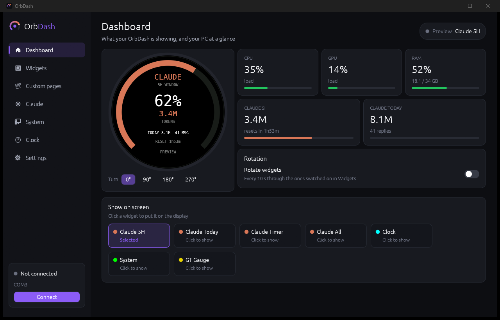
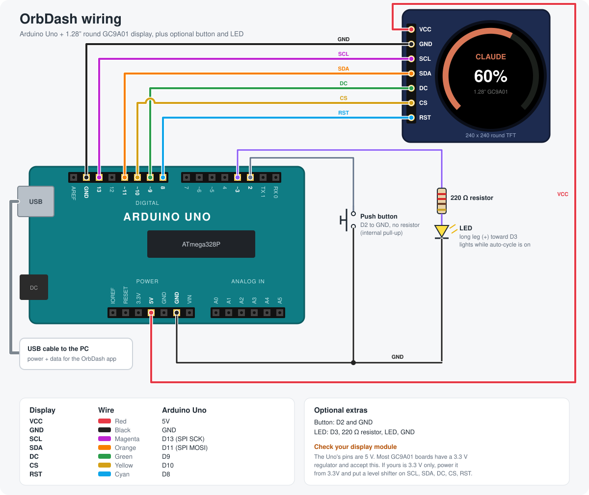
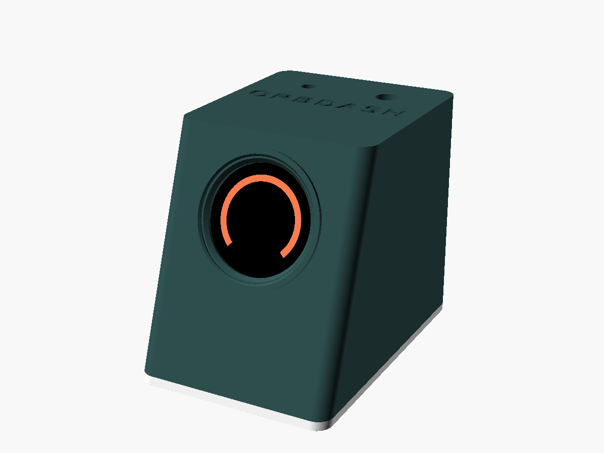

<p align="center"></p>

<p align="center"><b>Everything you watch, at a glance.</b></p>

# OrbDash

A desk dial for a 1.28" round GC9A01 display on an Arduino Uno, driven by a
Rust desktop app. It shows your Claude Code usage, a clock, live PC stats, a
race-car style gauge, and any number of custom pages you make yourself (text,
command output, countdowns, a pomodoro timer, 3D printer progress).



*The app's dashboard, in demo mode (`ORBDASH_DEMO=1` shows sample Claude
numbers instead of your own, handy for screenshots).*

## What's in here

| Path | What it is |
| --- | --- |
| [`firmware/OrbDash/`](firmware/OrbDash/OrbDash.ino) | Arduino firmware: draws the widgets, takes commands over USB serial |
| [`app/`](app) | **OrbDash**, the Rust (egui) desktop app that controls the screen and feeds it data |
| [`case/`](case) | 3D-printable case: STL files and the parametric OpenSCAD source |
| [`docs/`](docs) | Wiring diagram (and the script that draws it) and screenshots |
| [`brand/`](brand) | Logo, app icon, colours, type and the brand guide |
| [`claude_usage_bridge.py`](claude_usage_bridge.py) | Older, minimal Python script that only sends Claude usage. The app replaces it |

## Widgets

| # | Widget | Ring shows |
| --- | --- | --- |
| 1 | Claude 5H | Time elapsed in the current 5-hour block, or tokens vs a budget |
| 2 | Claude Today | Today's tokens vs a daily goal |
| 3 | Claude Timer | Time left until the 5-hour block resets |
| 4 | Claude All | Every Claude number on one screen |
| 5 | Clock | Seconds of the current minute |
| 6 | System | CPU load, plus RAM, network, disk and uptime |
| 7 | Custom | Whatever the app sends: title, value, subtitle, line, ring %, color |
| 8 | GT Gauge | Race-car style tachometer instead of the ring: the needle is CPU load (0-10 scale, redline from 85%), with GPU and RAM bars below. The needle sweeps to full scale when the widget opens |

GPU load comes from `nvidia-smi` on NVIDIA cards, otherwise from Windows'
GPU engine counters (the number Task Manager shows). Without either, the GPU
bar shows `--`.

The app can hold any number of **custom pages** that take turns in the
Custom slot. Each page gets its content from one of:

- **Fixed text**: you type the value and ring %.
- **Command output**: any shell command, run on an interval. The first line
  of output is `value|ring%|subtitle|bottom line` (only `value` is required;
  a bare number from 0 to 100 also fills the ring). Templates included for
  weather (wttr.in), laptop battery, and 3D printers: print progress on the
  ring and time left below.
  - **Biqu B1 / Marlin USB**: for printers that print from SD card and are
    plugged into the PC by USB. It asks the printer with `M27`/`M31` and finds
    its port by USB ID (BTT LPC176x and STM32 boards), so it leaves the
    Arduino alone. Nothing else may have the printer's port open.
  - **OctoPrint, Klipper (Moonraker), UltiMaker**: over the network. Put your
    printer's address in place of `PRINTER_IP` (and, for OctoPrint, an API
    key from its settings in place of `YOUR_API_KEY`).
- **Countdown to a date**: the ring fills as the date gets closer.
- **Pomodoro timer**: start, pause and reset it from the app.

## Hardware

- Arduino Uno (or Nano)
- 1.28" 240x240 round TFT, GC9A01 driver
- Optional: a push button, an LED and a 220 Ω resistor
- USB cable to the PC (powers the board and carries the data)



| Display pin | Wire color | Arduino pin |
| --- | --- | --- |
| VCC | Red | 5V |
| GND | Black | GND |
| SCL | Magenta | 13 (SPI SCK) |
| SDA | Orange | 11 (SPI MOSI) |
| DC | Green | 9 |
| CS | Yellow | 10 |
| RST | Cyan | 8 |

| Extra | Arduino pin |
| --- | --- |
| Push button | 2 and GND (uses the internal pull-up, no resistor) |
| Auto-cycle LED | 3 → 220 Ω resistor → LED long leg; LED short leg → GND |

The pin names on the display (SCL/SDA) are just labels: this is an SPI
display, so they go to the Uno's SPI pins 13 and 11, not the I2C pins.

> **Check your display module's voltage.** The Uno's pins are 5 V. Most
> GC9A01 boards have a 3.3 V regulator and accept this, but if yours is
> 3.3 V only, power it from the Uno's 3.3V pin and put a level shifter on
> SCL, SDA, DC, CS and RST.

**No PC:** when nothing arrives for 15 seconds (and at power-up until the
app connects), the screen shows a waiting animation. It goes back to the
widget as soon as data comes in.

**Button:** one tap shows the next widget, two taps rotate the screen 90°,
and a long press (over 1 s) toggles auto-cycle.

The diagram is generated by [`docs/wiring.py`](docs/wiring.py); edit it and
run `python docs/wiring.py` to redraw it.

## 3D-printed case

A small desk console that holds the Uno and shows the display in a tilted
front face. Three parts, no supports needed. STLs, print settings and
assembly steps are in [`case/`](case).



## Setup

### 1. Flash the firmware

Install the Arduino libraries **Adafruit GC9A01A** and **Adafruit GFX
Library** (Library Manager), then open `firmware/OrbDash/OrbDash.ino` and
upload it to the Uno.

With `arduino-cli`:

```bash
arduino-cli lib install "Adafruit GC9A01A" "Adafruit GFX Library"
arduino-cli compile --fqbn arduino:avr:uno -u -p COM3 firmware/OrbDash
```

### 2. Build and run the app

Needs a recent stable Rust toolchain.

```bash
cd app
cargo run --release
```

Pick the board's port and press **Connect** (or tick **Auto-connect**). The
board plays its intro, reports in, and the app starts streaming data. Close
the Arduino IDE's Serial Monitor first: only one program can use the port at
a time.

The app is developed and tested on Windows. Clock, System, custom pages and
the serial link are cross-platform; **Start with Windows** and the battery
template are Windows-only.

## Claude usage: how it's measured

The app reads your local Claude Code session logs
(`~/.claude/projects/**/*.jsonl`) and adds up the token counts in them.
Nothing is sent anywhere except to the board over USB.

- The 5-hour block is **estimated** from your logs: a block starts on the
  hour of its first message and lasts 5 hours. It is not Anthropic's official
  limit meter, so it won't match your plan's exact percentage.
- Only Claude Code on this machine is counted, not chats on claude.ai.
- Token totals include cache reads, so they look large.

## Serial protocol

115200 baud, one message per line, fields separated by `|`. Fields must not
be empty (send a space instead).

PC to board:

```text
U|<5h tokens>|<5h %>|<today tokens>|<msgs>|<time left>|<today %>   Claude usage
C|<HH:MM>|<SS>|<date>|<weekday>|<extra>[|<color>]                   Clock
S|<cpu %>|<ram %>|<ram text>|<line 1>|<line 2>[|<color>]            System stats
M|<title>|<value>|<subtitle>|<line>|<ring %>|<color>                Custom widget
G|<cpu %>|<gpu %>|<ram %>                                           GT gauge (gpu "-" = no reading)
W|<0-7>    show a widget
R|<0-3>    set rotation
A|<0/1>    auto-cycle off/on
```

Colors are RGB565 in hex, for example `DBAA` for Claude coral.

Board to PC:

```text
ORB|READY|<widgets>     finished booting
MODE|<n>                widget changed (also from the button)
ROT|<n>                 rotation changed
AUTO|<0/1>              auto-cycle changed
```

The Uno's serial receive buffer is only 64 bytes, so the firmware drains it
into a larger ring buffer during long redraws, and the app spaces lines about
90 ms apart.

## License

[MIT](LICENSE)
