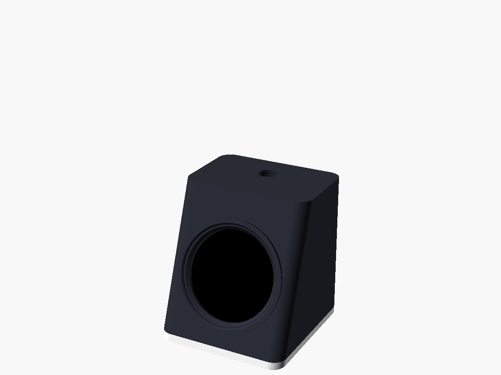
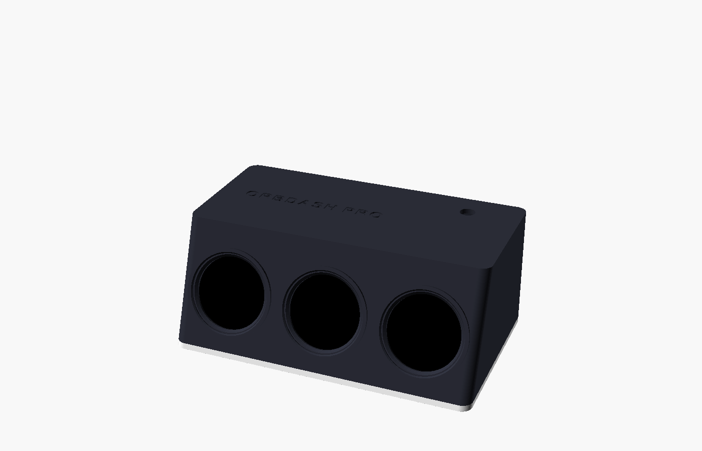
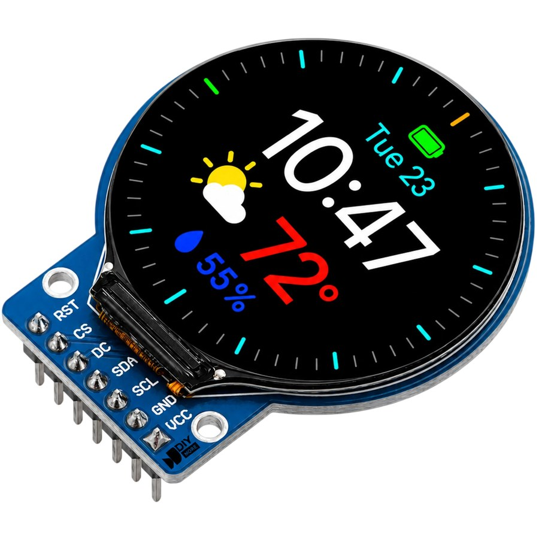
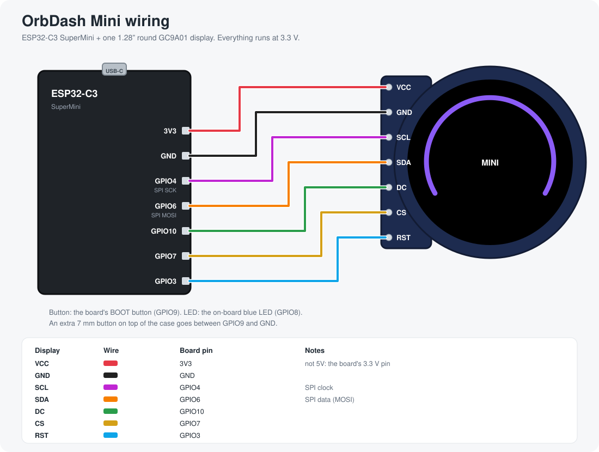
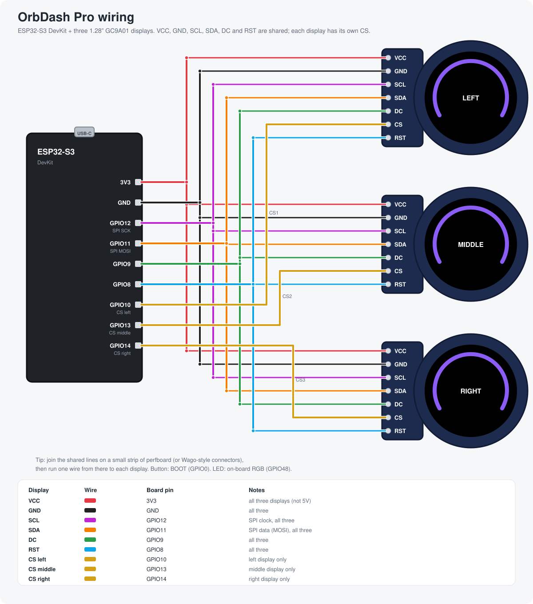

<p align="center"></p>

<p align="center"><b>Everything you watch, at a glance.</b><br>Version 1.2.0 · <a href="CHANGELOG.md">What's new</a></p>

# OrbDash

A desk dial with 1.28" round GC9A01 displays, driven by a Rust desktop app.
It shows your Claude Code usage, a clock, live PC stats, a race-car style
gauge, and any number of custom pages you make yourself (text, command
output, countdowns, a pomodoro timer, 3D printer progress).


*The app's dashboard, in demo mode (`ORBDASH_DEMO=1` shows sample Claude
numbers instead of your own, handy for screenshots).*

## The OrbDash family

| | **OrbDash** | **OrbDash Mini** | **OrbDash Pro** |
| --- | --- | --- | --- |
| |  |  |  |
| Board | Arduino Uno | ESP32-C3 SuperMini | ESP32-S3 DevKit |
| Screens | 1 | 1 | 3 in a row |
| Size (mm) | 64 × 94 × 76 | 50 × 52 × 56 | 142 × 86 × 58 |
| Firmware | [`firmware/OrbDash`](firmware/OrbDash) | [`firmware/OrbDashESP`](firmware/OrbDashESP) | [`firmware/OrbDashESP`](firmware/OrbDashESP) |
| Case | [`case/`](case) | [`case/mini/`](case/mini) | [`case/pro/`](case/pro) |
| Wiring | [below](#hardware-orbdash-arduino-uno) | [below](#hardware-orbdash-mini-esp32-c3) | [below](#hardware-orbdash-pro-esp32-s3) |

All three run the same widgets and talk to the same app over USB. The ESP32
versions draw each frame in memory and send it whole, so they never flicker,
and they are much faster. On the Pro, the app's Dashboard has a
**Left / Middle / Right** picker: click a widget and it goes on that screen.

## What's in here

| Path | What it is |
| --- | --- |
| [`firmware/OrbDash/`](firmware/OrbDash/OrbDash.ino) | Arduino Uno firmware: draws the widgets, takes commands over USB serial |
| [`firmware/OrbDashESP/`](firmware/OrbDashESP/OrbDashESP.ino) | ESP32 firmware for OrbDash Mini (ESP32-C3) and Pro (ESP32-S3) |
| [`app/`](app) | **OrbDash**, the Rust (egui) desktop app that controls the screen and feeds it data |
| [`case/`](case) | 3D-printable cases: the original in `case/`, plus `case/mini/` and `case/pro/` |
| [`docs/`](docs) | Wiring diagrams (and the scripts that draw them) and screenshots |
| [`brand/`](brand) | Logo, app icon, colours, type and the brand guide |
| [`claude_usage_bridge.py`](claude_usage_bridge.py) | Older, minimal Python script that only sends Claude usage. The app replaces it |

## Widgets

| # | Widget | Ring shows |
| --- | --- | --- |
| 1 | Claude 5H | Time elapsed in the current 5-hour block, or tokens vs a budget |
| 2 | Claude Today | Today's tokens vs a daily goal |
| 3 | Claude Timer | Time left until the 5-hour block resets |
| 4 | Claude All | Every Claude number on one screen |
| 5 | Clock | Seconds of the current minute |
| 6 | System | CPU load, plus RAM, network, disk and uptime |
| 7 | Custom | Whatever the app sends: title, value, subtitle, line, ring %, color |
| 8 | GT Gauge | Race-car style tachometer instead of the ring: the needle is CPU load (0-10 scale, redline from 85%), with GPU and RAM bars below. The needle sweeps to full scale when the widget opens |

GPU load comes from `nvidia-smi` on NVIDIA cards, otherwise from Windows'
GPU engine counters (the number Task Manager shows). Without either, the GPU
bar shows `--`.

The app can hold any number of **custom pages** that take turns in the
Custom slot. Each page gets its content from one of:

- **Fixed text**: you type the value and ring %.
- **Command output**: any shell command, run on an interval. The first line
  of output is `value|ring%|subtitle|bottom line` (only `value` is required;
  a bare number from 0 to 100 also fills the ring). Templates included for
  weather (wttr.in), laptop battery, and 3D printers on the network
  (OctoPrint, Klipper via Moonraker, UltiMaker): print progress on the ring
  and time left below. Put your printer's address in place of `PRINTER_IP`
  (and, for OctoPrint, an API key from its settings in place of
  `YOUR_API_KEY`).
- **Countdown to a date**: the ring fills as the date gets closer.
- **Pomodoro timer**: start, pause and reset it from the app.

## Hardware: OrbDash (Arduino Uno)

- Arduino Uno (or Nano)
- 1.28" 240x240 round TFT, GC9A01 driver
- Optional: a push button, an LED and a 220 Ω resistor
- USB cable to the PC (powers the board and carries the data)



**The display used in this project** is the 1.28" round GC9A01 module
(240 × 240, DIYmore and similar sellers): a round board with a tab carrying
a 7-pin header, `RST CS DC SDA SCL GND VCC`. The case is made for this
shape, tab included. Other round GC9A01 boards work too, but check their
pin order and size (see [`case/`](case)).

<sub>Module photo: DIYmore product image.</sub>
<br clear="right">


| Display pin | Wire color | Arduino pin |
| --- | --- | --- |
| VCC | Red | 5V |
| GND | Black | GND |
| SCL | Magenta | 13 (SPI SCK) |
| SDA | Orange | 11 (SPI MOSI) |
| DC | Green | 9 |
| CS | Yellow | 10 |
| RST | Cyan | 8 |

| Extra | Arduino pin |
| --- | --- |
| Push button | 2 and GND (uses the internal pull-up, no resistor) |
| Auto-cycle LED | 3 → 220 Ω resistor → LED long leg; LED short leg → GND |

The pin names on the display (SCL/SDA) are just labels: this is an SPI
display, so they go to the Uno's SPI pins 13 and 11, not the I2C pins.

> **Check your display module's voltage.** The Uno's pins are 5 V. Most
> GC9A01 boards have a 3.3 V regulator and accept this, but if yours is
> 3.3 V only, power it from the Uno's 3.3V pin and put a level shifter on
> SCL, SDA, DC, CS and RST.

**No PC:** when nothing arrives for 15 seconds (and at power-up until the
app connects), the screen shows a waiting animation. It goes back to the
widget as soon as data comes in.

**Button:** one tap shows the next widget, two taps rotate the screen 90°,
and a long press (over 1 s) toggles auto-cycle.

The diagram is generated by [`docs/wiring.py`](docs/wiring.py); edit it and
run `python docs/wiring.py` to redraw it.

## Hardware: OrbDash Mini (ESP32-C3)

- ESP32-C3 SuperMini (22 × 18 mm, USB-C)
- One 1.28" round GC9A01 display (the module above)
- Optional: a 7 mm push button on top of the case
- USB-C cable to the PC



| Display pin | ESP32-C3 pin |
| --- | --- |
| VCC | 3V3 |
| GND | GND |
| SCL | GPIO4 |
| SDA | GPIO6 |
| DC | GPIO10 |
| CS | GPIO7 |
| RST | GPIO3 |

Everything is 3.3 V, so no level shifter is needed. The button is the
board's own BOOT button (GPIO9); an extra button on top goes between GPIO9
and GND. The on-board LED lights while auto-cycle is on. In the Mini case the
display's tab points **up**: the firmware turns the picture to match.

## Hardware: OrbDash Pro (ESP32-S3)

- ESP32-S3 DevKit (DevKitC-1 or similar)
- Three 1.28" round GC9A01 displays
- A small strip of perfboard (or lever connectors) to join the shared lines
- Optional: a 7 mm push button on top of the case
- USB-C cable to the PC, in the board's **COM/UART** port



| Display pin | ESP32-S3 pin |
| --- | --- |
| VCC | 3V3 (all three) |
| GND | GND (all three) |
| SCL | GPIO12 (all three) |
| SDA | GPIO11 (all three) |
| DC | GPIO9 (all three) |
| RST | GPIO8 (all three) |
| CS | GPIO10 left, GPIO13 middle, GPIO14 right |

The button (BOOT, GPIO0) controls the middle screen; the on-board RGB LED
lights while auto-cycle is on. The diagrams are generated by
[`docs/wiring_esp.py`](docs/wiring_esp.py).

## 3D-printed cases

Each device has a desk console with the display(s) in a tilted front face.
Three parts each (shell, base plate, display retainer), no supports needed.
STLs, print settings and assembly steps are in [`case/`](case),
[`case/mini/`](case/mini) and [`case/pro/`](case/pro).


## Setup

### 1. Flash the firmware

Install the Arduino libraries **Adafruit GC9A01A** and **Adafruit GFX
Library** (Library Manager), then open `firmware/OrbDash/OrbDash.ino` and
upload it to the Uno.

With `arduino-cli`:

```bash
arduino-cli lib install "Adafruit GC9A01A" "Adafruit GFX Library"
arduino-cli compile --fqbn arduino:avr:uno -u -p COM3 firmware/OrbDash
```

For OrbDash Mini and Pro, install the **esp32** boards (Espressif, version
3.x) in the Boards Manager, open `firmware/OrbDashESP/OrbDashESP.ino`, and
pick the board: it decides which device you get.

```bash
# OrbDash Mini (ESP32-C3 SuperMini)
arduino-cli compile --fqbn esp32:esp32:esp32c3:CDCOnBoot=cdc -u -p COM5 firmware/OrbDashESP
```

```bash
# OrbDash Pro (ESP32-S3 DevKit, COM/UART port)
arduino-cli compile --fqbn esp32:esp32:esp32s3 -u -p COM6 firmware/OrbDashESP
```

Use your own port names. If the C3 doesn't show up for uploading, hold BOOT
while plugging it in.

### 2. Build and run the app

Needs a recent stable Rust toolchain.

```bash
cd app
cargo run --release
```

Pick the board's port and press **Connect** (or tick **Auto-connect**). The
board plays its intro, reports in, and the app starts streaming data. Close
the Arduino IDE's Serial Monitor first: only one program can use the port at
a time.

The app is developed and tested on Windows. Clock, System, custom pages and
the serial link are cross-platform; **Start with Windows** and the battery
template are Windows-only.

## Claude usage: how it's measured

The app reads your local Claude Code session logs
(`~/.claude/projects/**/*.jsonl`) and adds up the token counts in them.
Nothing is sent anywhere except to the board over USB.

- The 5-hour block is **estimated** from your logs: a block starts on the
  hour of its first message and lasts 5 hours. It is not Anthropic's official
  limit meter, so it won't match your plan's exact percentage.
- Only Claude Code on this machine is counted, not chats on claude.ai.
- Token totals include cache reads, so they look large.

## Serial protocol

115200 baud, one message per line, fields separated by `|`. Fields must not
be empty (send a space instead).

PC to board:

```text
U|<5h tokens>|<5h %>|<today tokens>|<msgs>|<time left>|<today %>   Claude usage
C|<HH:MM>|<SS>|<date>|<weekday>|<extra>[|<color>]                   Clock
S|<cpu %>|<ram %>|<ram text>|<line 1>|<line 2>[|<color>]            System stats
M|<title>|<value>|<subtitle>|<line>|<ring %>|<color>                Custom widget
G|<cpu %>|<gpu %>|<ram %>                                           GT gauge (gpu "-" = no reading)
W|<0-7>[|<screen>]   show a widget (screen 0-2 on the Pro; default 0)
R|<0-3>    set rotation
A|<0/1>    auto-cycle off/on
?          ask the board to say ORB|READY again (ESP32 boards don't restart
           when the port opens, so the app sends this on connect)
```

Colors are RGB565 in hex, for example `DBAA` for Claude coral.

Board to PC:

```text
ORB|READY|<widgets>|<version>[|<screens>|<device>]   finished booting
                        (version since 1.1.0; screens and MINI/PRO on ESP32)
MODE|<n>[|<screen>]     widget changed (also from the button)
ROT|<n>                 rotation changed
AUTO|<0/1>              auto-cycle changed
```

The Uno's serial receive buffer is only 64 bytes, so the firmware drains it
into a larger ring buffer during long redraws, and the app spaces lines about
90 ms apart.

## License

[MIT](LICENSE)
