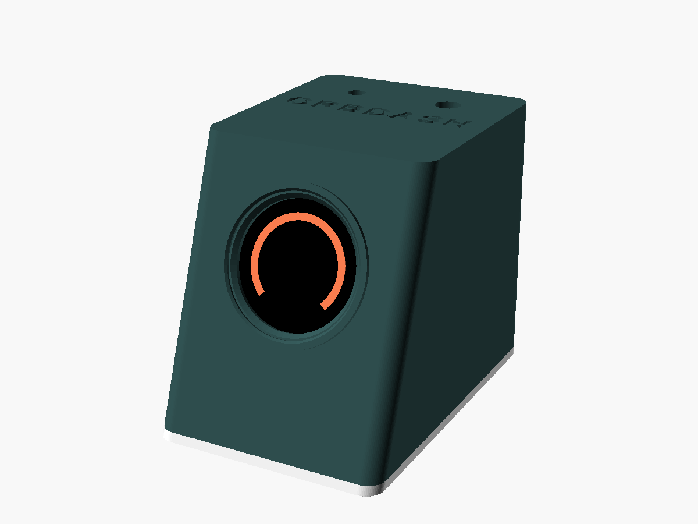
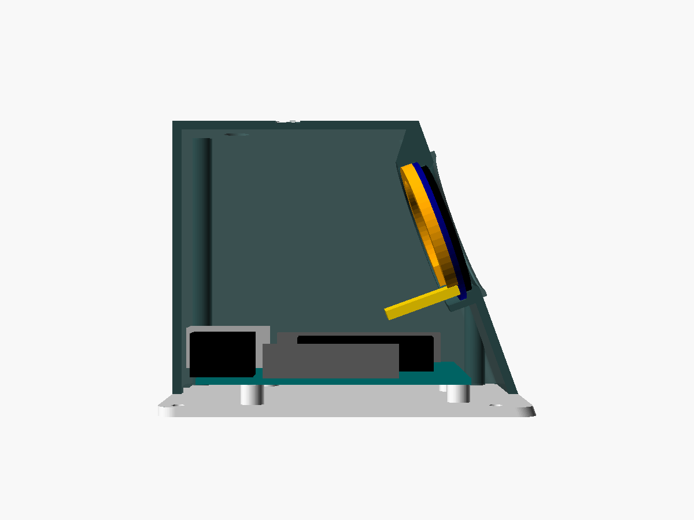

# OrbDash case

A small desk console for the Arduino Uno and the 1.28" round display. The
screen sits in a front face tilted back 20°, the Uno lies flat inside with its
USB and power jacks at the back, and the optional button and LED go through
the top.



Outside size: about **64 × 94 × 76 mm** (width × depth × height).

## Files

| File | What it is |
| --- | --- |
| [`stl/orbdash_shell.stl`](stl/orbdash_shell.stl) | Top, sides and tilted front. Already flipped upside down for printing |
| [`stl/orbdash_plate.stl`](stl/orbdash_plate.stl) | Base plate with the Uno standoffs and rubber-feet recesses |
| [`stl/orbdash_retainer.stl`](stl/orbdash_retainer.stl) | C-shaped ring that holds the display in from behind |
| [`orbdash_case.scad`](orbdash_case.scad) | The OpenSCAD source: every size is a parameter |

## Measure your display first

Round GC9A01 boards differ by a millimetre or two between sellers. Measure
yours and, if it differs, change these values at the top of
`orbdash_case.scad`, or in OpenSCAD's Customizer (Window → Customizer):

| Parameter | Default | What to measure |
| --- | --- | --- |
| `pcb_d` | 39.0 | Diameter of the round circuit board |
| `glass_d` | 35.6 | Diameter of the glass panel on the front |
| `glass_t` | 2.0 | Thickness of the glass panel |
| `view_d` | 32.6 | Diameter of the visible screen area |
| `header_gap` | 26 | Width the pin header and plugs need at the bottom |

Then export new STLs: pick a `part` (`shell`, `plate` or `retainer`), press
F6, then File → Export → STL. From the command line:

```bash
openscad -o stl/orbdash_shell.stl -D 'part="shell"' orbdash_case.scad
```

Set `part = "assembly"` to see a cut-away view with a dummy Uno and display,
handy for checking the fit after changing sizes.

## Printing

- **Material:** PLA or PETG
- **Layer height:** 0.2 mm, 3 walls, 15–20 % infill
- **Supports:** none. Print every part as exported:
  - the shell upside down, with its top on the bed;
  - the plate flat, with the standoffs pointing up;
  - the retainer flat.
- The top edge of the round screen window is a small overhang. If your
  printer droops there, add a support blocker everywhere except the window.

## Hardware

- 4 × M3 × 8 mm screws: plate to shell (countersunk heads fit flush)
- 4 × M3 × 6 mm screws: Uno to the standoffs. The holes are 2.6 mm, so the
  screws cut their own thread.
- Optional: a 7 mm panel-mount push button (set `btn_d = 12.2` for a 12 mm
  one), a 5 mm LED (or set `led_d = 3.1` for 3 mm), and 4 rubber feet up to
  10 mm across

## Assembly



1. **Display:** from the inside, push the display into the window with the
   glass facing out and the pin header at the **bottom**. Press the retainer
   ring in behind it, with the ring's gap over the header. A dot of hot glue
   on the ring keeps it from ever working loose. If the picture comes out
   sideways or upside down, turn it with the app's **Orientation** setting.
2. **Top panel:** fit the push button (its nut goes on the inside) and press
   the LED into its hole from below (a drop of glue holds it).
3. **Uno:** screw the Uno onto the plate's four standoffs with the USB and
   power jacks at the back edge.
4. **Wiring:** connect everything as in the
   [wiring diagram](../docs/wiring.svg). Plug the display's wires in before
   you close the case.
5. **Close:** lower the shell over the plate so the jacks line up with the
   openings in the back wall, then screw the plate on from below with the
   four M3 × 8 mm screws.
6. Stick the rubber feet into the recesses on the bottom.
