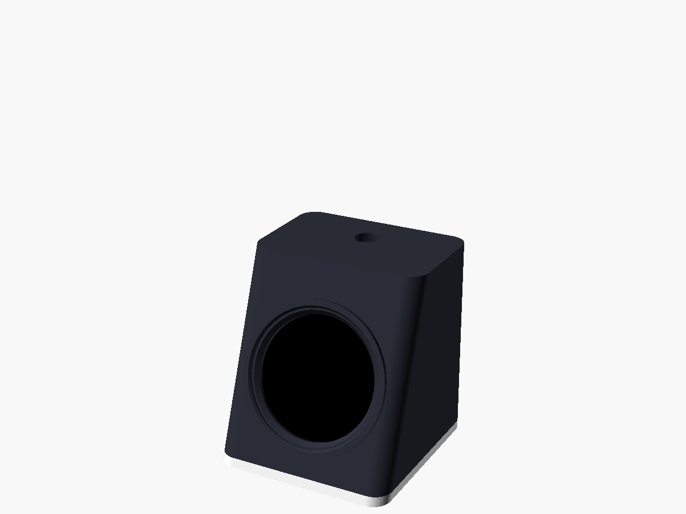

# OrbDash Mini case

A small pod for one 1.28" round display and an ESP32-C3 SuperMini. About
**50 × 52 × 56 mm**.

| File | What it is |
| --- | --- |
| [`stl/orbdash_mini_shell.stl`](stl/orbdash_mini_shell.stl) | Top, sides and tilted front. Already upside down for printing |
| [`stl/orbdash_mini_plate.stl`](stl/orbdash_mini_plate.stl) | Base plate with a fence that holds the SuperMini |
| [`stl/orbdash_mini_retainer.stl`](stl/orbdash_mini_retainer.stl) | C-ring that holds the display in from behind |
| [`orbdash_mini.scad`](orbdash_mini.scad) | OpenSCAD source (uses [`../lib/orbdash_body.scad`](../lib/orbdash_body.scad)) |

## Printing

PLA or PETG, 0.2 mm layers, 3 walls, no supports. Print each part as
exported: the shell upside down, the plate and retainer flat.

## Assembly

1. Solder short wires from the display's header to the SuperMini (see the
   [wiring](../../README.md#hardware-orbdash-mini-esp32-c3)). Dupont plugs fit
   too, but leave less room.
2. Push the display into the front from inside, **header tab pointing up**,
   then press the retainer in behind it.
3. Put the SuperMini in the fence on the plate, USB-C to the back. A dot of
   hot glue or double-sided tape keeps it there.
4. Optional: a 7 mm push button in the top hole, wired to GPIO9 and GND.
5. Screw the plate on with 4 × M3 × 8 mm screws.

Measure your display and change `tab_w`, `tab_reach` and `joint_h` at the top
of `../lib/orbdash_body.scad` if it differs (see the
[main case notes](../README.md#measure-your-display-first)).
