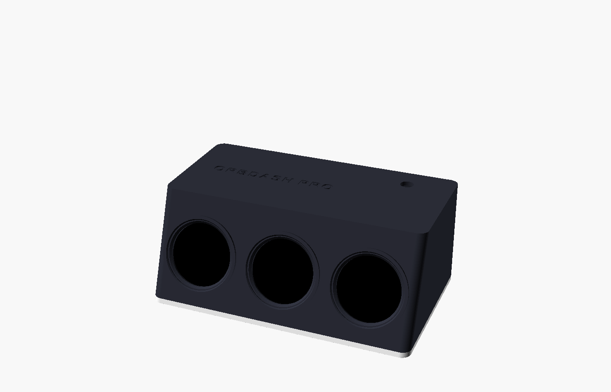

# OrbDash Pro case

A wide desk console with three 1.28" round displays in a row, like a car's
dash, and an ESP32-S3 DevKit inside. About **142 × 86 × 58 mm**.

| File | What it is |
| --- | --- |
| [`stl/orbdash_pro_shell.stl`](stl/orbdash_pro_shell.stl) | Top, sides and the tilted front with three screens. Already upside down for printing |
| [`stl/orbdash_pro_plate.stl`](stl/orbdash_pro_plate.stl) | Base plate with a fence that locates the DevKit, and rubber-feet recesses |
| [`stl/orbdash_pro_retainer.stl`](stl/orbdash_pro_retainer.stl) | C-ring that holds a display in from behind. **Print three** |
| [`orbdash_pro.scad`](orbdash_pro.scad) | OpenSCAD source (uses [`../lib/orbdash_body.scad`](../lib/orbdash_body.scad)) |

The shell needs a bed of at least 150 × 90 mm.

## Printing

PLA or PETG, 0.2 mm layers, 3 walls, no supports. Print each part as
exported: the shell upside down, the plate and retainers flat.

## Assembly

1. Push each display into the front from inside, **header tab pointing up**,
   and press a retainer in behind it.
2. Wire them as in the [wiring diagram](../../README.md#hardware-orbdash-pro-esp32-s3):
   VCC, GND, SCL, SDA, DC and RST are shared, so join them on a small strip
   of perfboard; each display's CS goes to its own pin.
3. Turn the DevKit upside down (pins up), stick it on 5 mm foam tape inside
   the fence on the plate, USB ports to the back hole. Plug the wires onto
   its pins.
4. Optional: a 7 mm push button in the top hole, wired to GPIO0 and GND.
5. Screw the plate on with 4 × M3 × 8 mm screws and add rubber feet.

The display sizes (`tab_w`, `tab_reach`, `joint_h`, ...) are at the top of
`../lib/orbdash_body.scad`; the spacing between screens is `spacing` in
`orbdash_pro.scad`.
